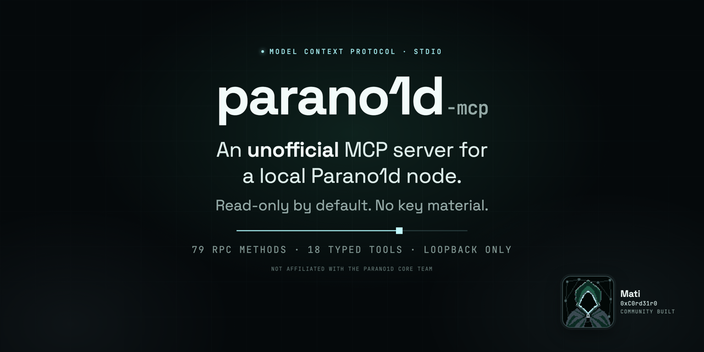

# parano1d-mcp

[](https://github.com/0xC0rd31r0/parano1d-mcp/actions/workflows/ci.yml)
[](LICENSE)
[](rust-toolchain.toml)
[](https://modelcontextprotocol.io)
[](#status)



An **unofficial** MCP server for a Parano1d node. 18 tools over stdio, read-only by default. The node's wallet signs; the server never sees a private key.

> Unofficial community project, not affiliated with the Parano1d Core team.

`parano1d-mcp` connects an MCP client — an editor, a desktop app, or any agent that speaks the Model Context Protocol over stdio — to a Parano1d node on the same machine. It maps the node's JSON-RPC API onto typed tools and enforces access modes, spend caps and activation gates in code.

It exists because raw RPC access is all-or-nothing: any client that can reach the node can also spend from its wallet. This server makes spending a separate, explicit, capped action, while keeping reads unrestricted.

## Status

**v0.1.3, pre-release.** Read-only mode is the supported deployment. Wallet mode is opt-in and
capped; admin mode and contract/native writes have not been exercised on mainnet (sends,
consolidation, contract and native writes have been exercised on a private test network). The server has
not been independently audited.

**Safety at a glance**

- Read-only by default. `wallet` and `admin` are explicit opt-in modes.
- No key material and no signing code. The node's wallet signs.
- Loopback-only HTTP. No remote RPC, no TLS, no listening port.
- Every spend needs a per-call cap. NOID sends also need a one-time plan and an exact confirmation; consolidation and native writes need a one-time plan; contract funding and calls need an explicit fee and are checked against the node's preview.
- Writes never retry.

## What it is

- A local stdio MCP server for one Parano1d node. One process per node.
- A typed view of the node's RPC: 79 methods on node v2.1.0, 68 on v2.0.4, detected at runtime.
- A guard layer: mode gates, per-call spend caps, quote-bound sends, native activation gating, and a read-only RPC passthrough.
- A single Rust binary. No runtime, no TLS stack, no telemetry, no filesystem access.

## What it is not

- Not a wallet or signer. It holds no keys, has no signing code, and cannot create or export a seed. In wallet mode it can ask the node's wallet to send, within caps.
- Not a node, miner, or process supervisor. It does not start, restart, or supervise the node. The only control call is an admin-only graceful `stop`.
- Not a remote or multi-user service. It opens no port, has no authentication, and refuses non-loopback RPC URLs.
- Not an HTTP MCP server. The transport is stdio only.
- Not a sandbox. Any local process that can reach `127.0.0.1:9601` already has the node's owner scope, with or without this server.
- Not a generic blockchain tool. It targets Parano1d's RPC and tracks its method surface.
- Not audited.

## Requirements

- Parano1d node v2.0.4 or v2.1.0, RPC at `http://127.0.0.1:9601` (default).
- Rust 1.96 to build; prebuilt binaries need no toolchain.
- The server must run on the same host as the node, because the RPC URL is restricted to loopback.

## Quick start

### Build

```sh
git clone https://github.com/0xC0rd31r0/parano1d-mcp
cd parano1d-mcp
cargo build --release --locked
```

The binary is `target/release/parano1d-mcp`. It reads environment variables and speaks MCP on stdin/stdout. `--check`, `--version` and `--help` are diagnostic entry points; there is no config file.

```sh
./target/release/parano1d-mcp --check
```

`--check` probes the node, prints its capabilities and exits 0 (or 1 if the node could not be read). It does not start the MCP server.

### Register with an MCP client

Add a stdio server entry that runs the binary. Cursor (`.cursor/mcp.json`) and VS Code (`.vscode/mcp.json`) accept this shape; VS Code uses a `servers` object with `"type": "stdio"` and passes the same fields.

```json
{
  "mcpServers": {
    "parano1d": {
      "command": "/absolute/path/to/parano1d-mcp",
      "env": { "PARANOID_MCP_MODE": "read" }
    }
  }
}
```

Start a new session and ask for the node overview. `node_overview` returns `mode: "read"`, the chain tip, and the node's contract and native capabilities. Any client that can launch a process and speak MCP over stdio works.

### Prebuilt binaries

Each release attaches archives for macOS (arm64), Linux (x86_64) and Windows (x86_64), a SHA-256 checksum file and build-provenance attestations. Verify a download before running it:

```sh
sha256sum -c SHA256SUMS                       # or: shasum -a 256 -c SHA256SUMS
gh attestation verify parano1d-mcp-v0.1.3-macos-arm64.tar.gz --repo 0xC0rd31r0/parano1d-mcp
```

The binaries are built with `cargo auditable`, so `cargo audit bin <binary>` also audits the exact
dependency set that shipped.

## Configuration

All configuration is environment variables. There are no secrets and no config file.

| Variable | Default | Meaning |
|---|---|---|
| `PARANOID_RPC_URL` | `http://127.0.0.1:9601` | Node RPC. Loopback IP literals only (`127.0.0.1`, `::1`). Hostnames such as `localhost`, credentials in the URL, remote hosts, and non-HTTP schemes are refused at startup. |
| `PARANOID_MCP_MODE` | `read` | `read`, `wallet`, or `admin`. Aliases: `ro`/`read-only`, `write`/`rw`. |
| `PARANOID_MCP_MAX_SEND_MICRONOID` | unset | Required for any NOID spend. Hard per-call cap on **amount + fee** (debit + fee for native operations). 1 NOID = 1,000,000 μNOID. |
| `PARANOID_MCP_MAX_FEE_MICRONOID` | unset | Optional additional fee-only cap for sends, consolidation, contract and native writes. |
| `PARANOID_MCP_ALLOW_RAW_INTENT` | unset | Set to `1` to allow `tx_submit`, which submits an already-signed intent. Off by default. |
| `PARANOID_MCP_MAX_RESULT_BYTES` | `524288` | Results larger than this are replaced by a truncated summary. Minimum 1024. |
| `RUST_LOG` | `warn` | Logs go to stderr. stdout is the MCP transport and must stay clean. |

Mode changes require restarting the server.

## Modes

| Mode | Adds | Intended use |
|---|---|---|
| `read` (default) | Every non-mutating method, wallet reads, and send planning | Monitoring, analysis, agent Q&A |
| `wallet` | `walletSend`, consolidation, address changes, contract funding and calls, native submit, raw signed intents with `PARANOID_MCP_ALLOW_RAW_INTENT=1` | A node you operate, with a small hot wallet |
| `admin` | `stop`, `getBlockTemplate`, `submitBlock` | Node operations and external-miner setups |

Modes are cumulative and enforced per method in `src/manifest.rs`. A tool that is not allowed in the current mode returns an error; it does not silently no-op.

## Tools

Method semantics follow the node's JSON-RPC API. The compiled manifest in `src/manifest.rs` is the
authoritative list of exposed methods, access classes and activation gates.

| Tool | Mode | What it does |
|---|---|---|
| `node_overview` | read | One batch call: chain tip, node and P2P status, mining, mempool, contracts, native protocol, wallet status, capabilities, mode, RPC method count |
| `chain_query` | read | 22 actions: block count, chain info, node status, block hash/header/details/block, headers by height or hash, history-step terminal, transaction, slot, slots by owner, active slot count, state info and map, recent transactions, epoch anchor, receipt verification, slot hints |
| `mempool_query` | read | `info`, `size`, `stats`, `entry` |
| `fee_estimate` | read | `estimateFee` and `estimateFeeDetailed`; inputs 1-1020, outputs 1-256 |
| `address_validate` | read | Validate and normalise an `o1...` address |
| `wallet_read` | read | `status`, `balance`, `address`, `list_addresses`, `active_address`, `utxos`, `utxo_snapshot`, `history`, `receipts`, `query_receipts` (v2.1), `mined_blocks`, `export_receipt` |
| `wallet_plan_send` | read | Quote a NOID send from the active address; returns a 120-second `plan_id` bound to the source, network, destination, amount and fee |
| `wallet_send` | wallet | Send NOID from the active address. Requires a matching `plan_id`, a fresh quote, the exact confirmation string and a spend cap; optional `from_index` must equal the active index; reports the node's `network` |
| `tx_submit` | wallet | Submit an already-signed intent. Requires `PARANOID_MCP_ALLOW_RAW_INTENT=1` and `confirm = "SUBMIT SIGNED INTENT"`. The cap cannot inspect an already-signed intent |
| `wallet_maintenance` | wallet | `scan`, `discover_addresses`, `next_address`, `set_active_address` (requires `confirm = SET ACTIVE ADDRESS <index>`), `plan_consolidation`, `consolidate`; `plan_consolidation` is a read and works in read mode |
| `contract_read` | read | `protocol`, `preview_call`, `status`, `instances`, `get_opening`, `list_states`, `list_receipts`, `export_receipt`, `verify_receipt` |
| `contract_write` | wallet | `create`, `fund`, `call`, `watch`, `import_receipt`. `fund` and `call` require an explicit non-zero fee; use `contract_read preview_call` or `fee_estimate` to obtain it. `call` previews the identical request first and caps what the node would release |
| `native_read` | read | v2.1 native: `protocol`, `catalog`, `market`, `holdings`, `wallet_holdings`, `pending`, `preview` |
| `native_write` | wallet | `submit` a previewed operation (requires native activation), or `dismiss_pending` (requires a v2.1 node) |
| `peer_report` | read | Peer count and every aggregate P2P/quorum metric the node exposes. States explicitly that no per-peer IP, port, or latency RPC exists |
| `mining` | read/admin | `info` and `peers` in read mode; `block_template` and `submit_block` require admin |
| `node_control` | admin | Graceful `stop`, bound to `STOP AT HEIGHT <current height>` |
| `rpc_call` | read | Read-only passthrough for any method in the manifest. Refuses every write and control method |

Input schemas are generated from the Rust types and are available through `tools/list`. Every tool that takes an argument object rejects unknown fields (`additionalProperties: false`), so a typo such as `amount` instead of `amount_micronoid` is an error rather than a silently ignored field. Results whose returned text is larger than `PARANOID_MCP_MAX_RESULT_BYTES` are replaced by a summary; node error messages are bounded to 2,000 characters; raw block hex is opt-in per call.

## Safety model

**Read-only by default.** `PARANOID_MCP_MODE=read` is the default and the recommended registration. `rpc_call` cannot bypass a mode: it refuses every method classified as wallet or admin.

**No key material.** The server holds no keys, tokens, or credentials. It never reads `~/.parano1d`, `wallet.key`, `p2p_identity.key`, `wallet.receipts`, or any node file; it contains no filesystem code and no signing code. Transactions are signed by the node's wallet.

**Loopback only.** The RPC URL must be HTTP on `127.0.0.1` or `::1`. URLs with credentials, hostnames, or a remote host are refused at startup. The node treats loopback as local-owner scope, and this server has no credential to present to a remote node.

**Send binding.** `wallet_plan_send` records the active source key index and address, and the node's network (`mainnet` or `testnet`, from `getNodeStatus.testnet`). `wallet_send` requires that plan, the identical destination, amount and fee argument, the same active source, a fresh quote, and the exact confirmation `SEND <amount_micronoid> MICRONOID TO <address>`. Pass `0` as the fee argument if you let the node choose; the quoted fee is shown for review but is not the bound argument. An optional `from_index` must equal the active index. Wallet-signing operations are serialized inside one MCP process; if another process or the GUI switches the active address after planning, the send is refused and must be re-quoted. `wallet_maintenance set_active_address` requires `SET ACTIVE ADDRESS <index>`, because it changes the signing address and mining payout. The plan is one-time use and expires after 120 seconds; a call that reaches plan validation consumes it, even if the source, destination, amount or fee does not match. The quoted fee is passed back to the node, so it cannot choose a larger fee between the re-quote and the write. `wallet_send` re-reads the network and refuses if it changed, so a plan quoted on one chain can never be submitted on another; a node that does not report `testnet` is refused rather than guessed at.

**Spend caps.** Every spending write requires `PARANOID_MCP_MAX_SEND_MICRONOID`. It caps the **total** per call — amount plus fee (or native debit plus fee) — so a tiny amount with a large fee cannot bypass the cap. The optional fee cap is an additional fee-only bound, applied to a node-chosen quoted fee as well as an explicit one. Caps are per call, not a cumulative budget. Contract funding and calls require an explicit non-zero fee, because a zero fee asks the node to choose the minimum and the MCP cannot verify that value. A contract call is previewed with the identical request and capped at the previewed payout plus fee, because a closing (`terminal`) call carries no payout field yet releases the whole contract balance to the recipient its terms commit. A native trade signs only bounds, and the block it lands in decides the fill, so it is capped at the larger of its quote and what it signs: a buy at `gross_input + fee_limit`, a sell at `fee_limit`; the fee cap applies to `fee_limit`. Every other native operation is capped at its exact debit plus fee. At most 64 unredeemed plans of each kind are kept; the oldest is dropped first.

**No write retries.** Reads retry once on a transport error. Writes never retry, because a retry could duplicate a send. If a write's response is lost (timeout, reset, unreadable reply), the node may already have accepted it: the tool reports **outcome unknown** with what to check, never a plain failure, and never resends.

**Activation gate.** Native v2.1 writes are refused until the node reports the native protocol active at the next block, or the tip has reached the activation height. The server reads this from `getNativeProtocol` and `getContractProtocol`; it does not hard-code a node version. After activation, `native_write` unlocks without a rebuild or restart.

**Height-bound stop.** `node_control` is admin-only and requires `STOP AT HEIGHT <current height>`, so a stale command cannot stop the node. The server never starts, restarts, or supervises the node.

### Trust boundary

The node's RPC is unauthenticated. Any local process that can reach `127.0.0.1:9601` has the same owner scope, with or without this server. `parano1d-mcp` adds guardrails against accidental and agent-driven spends; it is not an access-control layer and not a sandbox.

Two consequences follow:

1. Run it on a single-user machine. Do not expose the node's RPC port to a network, and do not run the server where untrusted users can connect to loopback.
2. Treat chain data as untrusted input. Token names, mempool entries, contract metadata and RPC error strings reach the model's context; an attacker can put instructions there. Review write calls and do not auto-approve wallet or admin tools.

Tool definitions are compiled into the binary and are not fetched at runtime, so a compromised node cannot change the descriptions the client sees. It can still return malicious data, which is why the second point stands.

### What this does not protect against

- A malicious or compromised local process with access to the node RPC.
- An MCP client that auto-approves `wallet_send` or `node_control`.
- A user who enables wallet mode with a larger cap than they intend to risk.
- Prompt injection in chain data.
- Bugs in the node, the wallet, or the chain.
- Cumulative spending: caps are per call, not a budget.

## Limitations

- **Peer detail.** The node exposes peer counts and aggregate P2P/quorum health, but no per-peer IP, port, direction, or latency RPC. `peer_report` reports what exists and states what does not. It does not read `peers.json` or guess.
- **Native v2.1 on mainnet.** Native reads work before activation and return the activation state and empty catalogues. Native writes are refused until the node reports activation. On mainnet the activation height is 279,370 at the time of this release.
- **Admin mode and contract/native writes are unexercised.** Wallet mode is capped and
  plan-bound, but admin mode, contract writes and native writes have not been run against
  mainnet. Use read mode in production until you have tested the mode you need against a node you
  can afford to lose.
- **No per-address send RPC.** The node's `walletSend` spends only the active address's UTXOs. To send from another local address, switch it active with `wallet_maintenance set_active_address` (confirmed), then send; the MCP does not switch automatically.
- **Caps are not a budget.** `PARANOID_MCP_MAX_SEND_MICRONOID` applies to each call, including the fee. An agent that can call `wallet_send` repeatedly can spend up to the cap each time. Use a dedicated wallet with a small balance.
- **No remote RPC, no TLS, no authentication.** By design; see above.
- **No HTTP transport.** stdio only. A client that cannot launch a process cannot use it.
- **One node per process.** Run one instance per node.
- **No Docker image.** A loopback-only server in a container does not reach the host's loopback without host networking, which is platform-specific. Use a release binary or build from source.
- **Not audited.** `src/safety.rs`, `src/manifest.rs`, and `src/config.rs` contain the security-relevant logic; they are small and intended to be read.

## Architecture

```
MCP client (any stdio client)
        |  MCP over stdio (JSON-RPC on stdin/stdout)
        v
  parano1d-mcp
        |  HTTP JSON-RPC, loopback, no TLS
        v
  127.0.0.1:9601  parano1d-node
        |
        +-- owns the wallet and signs
        +-- owns the chain data
```

- `src/manifest.rs`: one entry per RPC method with access class, version and activation gate. Adding a node method is a one-line change.
- `src/capabilities.rs`: probes `getNativeProtocol` and `getContractProtocol` in one batch, so activation is read from the node.
- `src/safety.rs`: send, consolidation and native plan stores, TTLs and confirmation strings.
- `src/rpc.rs`: HTTP client for single and batch calls, with timeouts and no retries on writes.
- `src/tools/`: the 18 MCP tools, grouped by domain.

TLS is deliberately not compiled in. The connection never leaves the host, so a TLS stack would add dependencies and attack surface without changing the trust boundary.

## Compatibility

| Node | RPC methods | Notes |
|---|---|---|
| v2.1.0 | 79 | Adds 10 native methods and `walletQueryReceipts`; native writes gated on activation |
| v2.0.4 | 68 | Chain, wallet, contracts, mempool, mining, control |

The server detects capabilities at startup and per call. It does not hard-code a node version; a method missing from the manifest is refused with a clear error rather than forwarded blindly.

## Platform support

| Platform | Runtime requirements | Notes |
|---|---|---|
| macOS 13+ arm64 / x86_64 | Execute permission | Unsigned binaries may trigger Gatekeeper; build locally or use a signed release |
| Linux x86_64 / arm64 (glibc) | Execute permission | No OpenSSL, CMake, or NASM needed |
| Windows 10/11 x86_64 | Execute permission | SmartScreen may prompt for an unsigned binary |

No admin or root access, firewall rule, Full Disk Access, Keychain access, or Local Network permission is required. The server opens no listening socket.

CI runs on Ubuntu x86_64, macOS arm64 and Windows x86_64. macOS x86_64 and Linux arm64 build from source; they are not CI-tested yet.

## Testing

```sh
cargo test --locked
cargo clippy --all-targets --locked -- -D warnings
cargo fmt --all -- --check
cargo build --release --locked
```

Unit tests cover configuration validation (including loopback rejection), the method manifest (access classes, method counts, dangerous methods not classified as read), plan binding and confirmation strings, cap parsing, result capping, and the CLI flags.

`tests/hostile_rpc.rs` needs no node and runs in the normal `cargo test` on every platform. It
starts the real binary against a scripted hostile JSON-RPC peer on an ephemeral loopback port
(never a node port) and checks oversized streams, lying content-lengths, invalid UTF-8/JSON,
deeply nested JSON, response-id mismatch, reordered/missing/duplicate batch ids, redirects, 4xx/5xx,
closed and stalled connections, non-integer amounts, unknown fields, every write refusal, a plan
whose source, quote or network changes before the send, a cancelled send, and that a refused send
or stop never reaches the node. Every write tool is checked to be annotated destructive and not
read-only.

Integration tests spawn the real binary and speak MCP over stdio. They need a running node and are opt-in:

```sh
PARANOID_MCP_LIVE_TEST=1 cargo test --locked --test stdio_live -- --test-threads=1
```

The endpoints are configurable with `PARANOID_MCP_LIVE_URL` (default `http://127.0.0.1:9601`) and `PARANOID_MCP_LIVE_TESTNET_URL` (default `http://127.0.0.1:19821`). The live suite is written against a v2.1 node with a wallet. It exercises reads and refusal paths only and never sends a transaction. It is not run in CI, because CI has no node.

## Development

- Rust 1.96, edition 2024, pinned by `rust-toolchain.toml`.
- `cargo build --release --locked` is the release build.
- CI runs formatting and clippy once, then tests and a release build on Ubuntu, macOS and Windows. `cargo-deny` checks advisories, licenses and sources on every run and weekly.
- `Cargo.lock` is committed; this is a binary, not a library.

## Security

Report vulnerabilities privately. See [SECURITY.md](SECURITY.md). Do not open a public issue for a guard bypass or a spend-cap bypass.

## Contributing

See [CONTRIBUTING.md](CONTRIBUTING.md). Changes to `src/manifest.rs`, `src/safety.rs`, or anything that can spend NOID need tests for the refusal path as well as the happy path.

## Maintainer

Maintained by [@Mathias_SaaS](https://x.com/Mathias_SaaS).

## License

Apache-2.0. See [LICENSE](LICENSE). The Parano1d node is Apache-2.0 as well.
